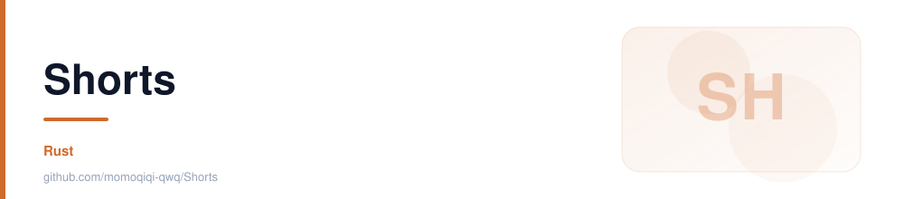

<div align="center">



**Shorts**

[](https://github.com/momoqiqi-qwq/Shorts/stargazers)  

</div>

<details open>
<summary><b>目录</b></summary>

- [✨ 项目简介](#-项目简介)
- [🎨 主要特点](#-主要特点)
- [📦 包含模块](#-包含模块)
- [🛠️ 如何使用](#️-如何使用)
- [❓ 效果演示](#-效果演示)
- [🙏 贡献](#-贡献)

</details>

---

---

---

---

---

---

# Shotrs · Rust 跨平台截图工具

### ✨ 项目简介

**Shotrs** 是一个从零搭建的跨平台桌面截图工具，纯 **Rust** 实现（egui/eframe + xcap + image + ravif + arboard）。点击小窗口的「开始截图」才进入全屏遮罩，支持矩形 / 椭圆 / 自由手绘 / 多边形 / 全屏 / 窗口悬停识别六种取景方式，导出 PNG 到 AVIF 共 6 种格式并自动复制到剪贴板。所有行为通过 TOML 配置持久化，无任何运行时依赖的第三方服务。

### 🎨 主要特点

- 🖊️ **六种取景**：矩形、Shift 锁正方形、椭圆/圆形、Lasso 手绘、多边形双击闭合、全屏、窗口悬停识别
- 🧊 **冻结屏幕**：先截主屏画面再绘制选区，拖拽时内容不变化
- 🎨 **异形透明**：椭圆、Lasso、多边形区域外像素自动透明
- 📦 **6 种导出格式**：PNG / JPEG / WebP / BMP / GIF / AVIF，质量可调（WebP 支持有损/无损）
- 🌈 **彩虹边框**：直播、教学、高对比场景下选区更醒目，动画速度与宽度可调
- ⚙️ **全量可配置**：遮罩 RGBA、选框颜色、线宽、工具栏位置、主题（light/dark/system）TOML 持久化

### 📦 包含模块

1. **设置小窗**—— 主窗口常驻极小，减少干扰
2. **截图遮罩层**—— 全屏覆盖、形状绘制、尺寸标签与坐标放大镜
3. **导出管线**—— 按形状裁剪、格式/质量参数、自动复制剪贴板、文件名模板
4. **配置系统**—— `shotrs/config.toml` 持久化 + CLI 主题覆盖
5. **CI 脚本**（`scripts/`、`.github/`）—— Windows 构建 PowerShell 与 Actions 工作流

### 🛠️ 如何使用

1. **Windows 构建**：

   ```powershell
   cargo build --release
   .\target\release\shotrs.exe --theme system
   # 或一键脚本
   powershell -ExecutionPolicy Bypass -File .\scripts\build-windows.ps1
   ```

2. **Linux 构建**（需系统库）：

   ```bash
   sudo apt-get install -y pkg-config libclang-dev libxcb1-dev libxrandr-dev \
     libdbus-1-dev libpipewire-0.3-dev libwayland-dev libegl-dev
   cargo build --release
   ```

3. **GitHub Actions**：推送到 GitHub 后在 Actions → Build Windows exe → Run workflow，产物在 Artifacts
4. **截图流程**：启动后点「开始截图」→ 全屏遮罩上画选区 → Enter 确认（Esc 取消）→ 自动复制到剪贴板

### ❓ 效果演示

```
shotrs.exe → [开始截图] → 全屏冻结遮罩
拖拽出矩形（实时显示 1280 × 720 尺寸标签）
悬停窗口 → 边框高亮 → 单击整窗截取
Enter → 保存 screenshot_20260906_013000.png + 已复制到剪贴板 ✓
```

（GUI 截图待补充）

### 🙏 贡献

Roadmap 上已经列好了方向：全局快捷键、多显示器拼接、标注工具、OCR、上传图床、截图历史、HiDPI 适配与 macOS/Wayland 权限处理——欢迎认领实现。

> 本 README 按照 [App-Showcase-Template](https://github.com/yxs2003/App-Showcase-Template) 的展示流程编写。
